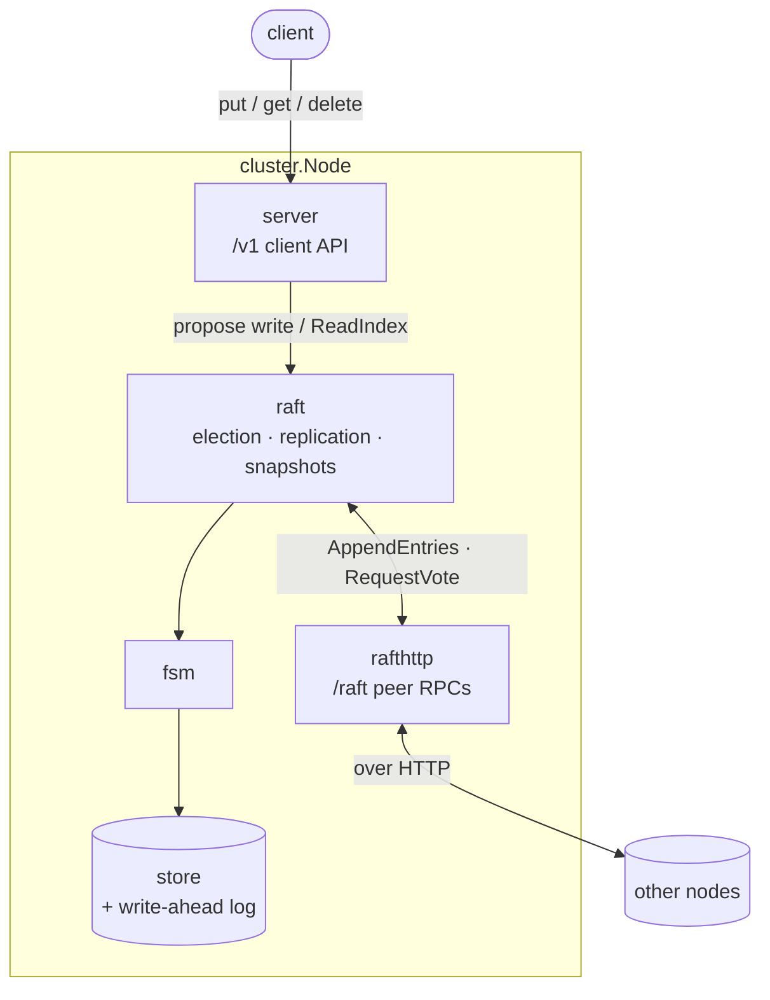
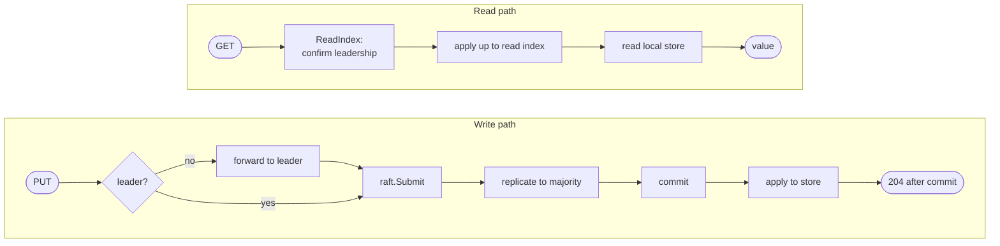

<div align="center">


# Keva

**A distributed, strongly consistent key-value store in Go, built on Raft.**


</div>

Keva replicates every write through consensus, serves linearizable reads,
survives node and network failures, and reshapes its own cluster membership
while running — and it is verified the way distributed systems have to be:
under partitions, crashes, and randomized chaos.

Keva was built chapter by chapter as a study in distributed systems; the full
design walkthrough lives in [`docs/`](docs/) (and is published as a reading
site — see [Design docs](#design-docs)).

## Highlights

- **Raft consensus** — leader election, log replication, and persistence,
  implemented from the paper rather than wrapped from a library.
- **Linearizable reads and writes** — writes commit through a majority before
  they are acknowledged; reads are served via the ReadIndex protocol and stay
  correct across leader changes.
- **Durable & crash-safe** — a write-ahead log and crash-safe persistence; a
  restarted node recovers its state by replaying the log.
- **Log compaction** — snapshots bound log growth, and a far-behind follower is
  caught up with an InstallSnapshot transfer.
- **Dynamic membership** — add or remove nodes on a running cluster, one at a
  time, with no split brain.
- **Operable** — durable write acknowledgment with deadlines, load-shedding
  backpressure, a `/v1/status` endpoint, and graceful shutdown that hands off
  leadership with no serving gap.
- **Fast** — concurrent reads share one confirmation round and concurrent
  writes share one fsync (group commit).
- **Proven correct** — a linearizability checker, a Raft safety-invariant
  checker, and a randomized chaos suite, all run under the race detector.

## Quickstart

```bash
make build        # compile ./bin/kevad (daemon) and ./bin/keva (client)
```

Run a three-node cluster locally, each node in its own terminal:

```bash
./bin/kevad --id n1 --addr :7070 --peers n2=localhost:7071,n3=localhost:7072 --data ./data/n1
```

```bash
./bin/kevad --id n2 --addr :7071 --peers n1=localhost:7070,n3=localhost:7072 --data ./data/n2
```

```bash
./bin/kevad --id n3 --addr :7072 --peers n1=localhost:7070,n2=localhost:7071 --data ./data/n3
```

Then use the client against any node — writes are forwarded to the leader
automatically:

```bash
./bin/keva --addr http://localhost:7070 put city pune
./bin/keva --addr http://localhost:7071 get city        # -> pune, from any node
./bin/keva --addr http://localhost:7072 delete city
```

Inspect a node's state at any time:

```bash
curl -s http://localhost:7070/v1/status
```

Or run the whole thing — cluster, writes, a leader kill, and failover — as a
single self-contained demo:

```bash
make demo
```

## Architecture

A single `cluster.Node` wires the pieces together behind one HTTP handler
serving the client API (`/v1`), the peer RPC API (`/raft`), and `/metrics`.



### Request flow

A write is acknowledged only after it commits; a read is confirmed by the
leader before it is served.



| Package            | Responsibility                                               |
| ------------------ | ------------------------------------------------------------ |
| `internal/keva`    | Core domain types shared across packages.                    |
| `internal/store`   | Storage engine: write-ahead log, recovery, compaction.       |
| `internal/raft`    | Consensus: election, replication, snapshots, membership.     |
| `internal/rafthttp`| HTTP transport for Raft RPCs between nodes.                  |
| `internal/server`  | Client HTTP API; forwarding, backpressure, status.           |
| `internal/cluster` | Wires a node's store, Raft, transport, and handlers together. |
| `cmd/kevad`        | Server daemon.                                               |
| `cmd/keva`         | Command-line client.                                         |

See [ARCHITECTURE.md](ARCHITECTURE.md) for the design overview.

## Correctness

Keva is tested as an adversary would attack it, all under `go test -race`:

- **Linearizability checker** — concurrent client histories are verified against
  a single-register model (a Wing–Gong search), confirming the whole stack
  behaves as one consistent store under concurrency.
- **Safety-invariant checker** — after every step of a scenario, all nodes are
  checked for Raft's safety properties: at most one leader per term, log
  matching, and no divergence among committed entries.
- **Randomized chaos** — a reproducible storm of writes, elections, partitions,
  node isolation, reconnection, and snapshots, asserting the invariants after
  every step and that no acknowledged write is ever lost.
- **Partition safety** — a minority can neither elect a leader nor commit, the
  majority keeps serving, and the cluster reconverges on heal.

Each checker is also fed a hand-built violation to prove it actually fails on
bad state — a checker that never fires proves nothing.

## Performance

Both costly steps of consensus are amortized across concurrent operations: a
burst of reads shares one leadership-confirmation round, and a burst of writes
shares one fsync. Illustrative in-memory-transport benchmarks (protocol
overhead, isolated from disk and network):

| Path                 | ns/op   | Note                                        |
| -------------------- | ------- | ------------------------------------------- |
| store Put / Get      | ~80     | bare store — the ceiling                    |
| write, serial        | ~21,000 | one proposal's own round                    |
| write, parallel      | ~10,000 | group commit — ~2× the per-op throughput    |
| read, parallel       | ~420    | batched confirmation                        |

```bash
make build && go test -run '^$' -bench . ./internal/raft/ ./internal/store/
```

## Monitoring

Each node exposes Prometheus metrics at `/metrics` — request rate, latency
histograms, and live Raft state (term, commit vs. applied index, which node is
leader). A one-command stack brings up a three-node cluster, a load generator,
Prometheus, and a pre-provisioned Grafana dashboard:

```bash
make monitor        # docker compose up --build
```

- **Grafana** — <http://localhost:3000> (anonymous admin; the "Keva Cluster"
  dashboard is provisioned automatically)
- **Prometheus** — <http://localhost:9090>
- **A node's raw metrics** — <http://localhost:7070/metrics>

The load generator drives steady traffic so the dashboard is live. To watch a
failover, stop the current leader and see a new one elected and the client
error rate recover:

```bash
docker compose stop keva1   # whichever node is currently leader
make monitor-down           # stop everything and clear volumes
```

## Design docs

The project was built and documented chapter by chapter, from the storage
engine through consensus, cluster operations, correctness, hardening, and
performance. The chapters live in [`docs/`](docs/) as a small reading site —
open [`docs/index.html`](docs/index.html) locally, or read the published
version at <https://0xnikshi.github.io/keva/>.

## Development

```bash
make test         # run the test suite
make test-race    # run with the race detector
make cover        # total test coverage
make vet          # go vet
make fmt          # format
make lint         # golangci-lint
make help         # list all targets
```

## Project layout

```
cmd/
  keva/         client CLI
  kevad/        server daemon
internal/
  keva/         core domain types
  store/        storage engine
  raft/         consensus
  rafthttp/     Raft RPC transport
  server/       client HTTP API
  cluster/      node wiring
docs/           design docs (reading site)
```
